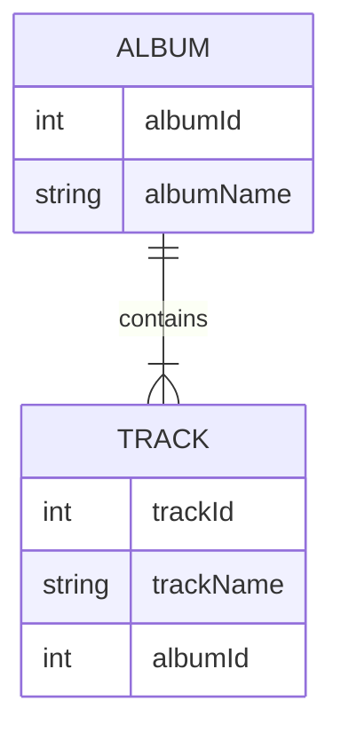

Replikátor dat umí synchronizovat vaše data v souborech NDJSON (datové archivy) se skutečnou databází. Zachovává přitom vztahy. Synchronizace je jednosměrná, z dat datového archivu do databáze.

Replikátor dat se spouští z [Nasazovače dat](data-deployer)

### Co znamená zachování vztahů?

Reference jsou definovány cizími a primárními klíči. Tyto hodnoty se mohou v databázi a v archivu lišit, ale replikátor dokáže zachovat vztahy mezi entitami.

Ukážeme si to na dvou souvisejících tabulkách – Album a Track.

Tabulka Album vypadá následovně. Při vkládání do databáze je albumId=1 již obsazeno, takže replikátor zvolí první volné ID, kterým je v tomto příkladu 11:
| albumId - archiv    | albumId - databáze | albumName |
| ----------- | ----------- | ----------- |
| 1      | 11 | A Hard Day's Night       |
| 2   | 12| Yellow Submarine        |

Tabulka Track má referenci na album, takže musí použít skutečná ID (11, 12) použitá v databázi namísto ID uložených v souboru NDJSON (1, 2). Pro zjednodušení předpokládáme, že trackId je stejné v databázi i v archivu.

| trackId | albumId - archiv    | albumId - databáze | albumName |
| ----------- | ----------- | ----------- | ----------- |
| 21 | 1      | 11 | A Hard Day's Night       |
| 22 | 2   | 12| If I fell        |

Nastavení pro jednotlivé tabulky
- Klíč (porovnávací sloupce) – toto nastavení je sdíleno s porovnáním v nasazovači dat, definuje unikátní kombinaci sloupců používanou pro párování entity
- Najít existující řádek – zaškrtněte, pokud chcete v databázi vyhledat existující řádek. Pokud není zaškrtnuto, jedinou možnou operací bude pokaždé vytvořit nový řádek
  - Podmínka hledání – definujte podmínku, v databázi budou vyhledávány pouze řádky odpovídající této podmínce
- Aktualizovat existující řádek – dostupné pouze v případě, že je zaškrtnuto „Najít existující řádek“. Zaškrtněte, pokud chcete nalezený řádek aktualizovat hodnotami z archivu
  - Podmínka aktualizace – definujte podmínku, aktualizovány budou pouze řádky odpovídající této podmínce
- Smazat chybějící řádek – dostupné pouze v případě, že je zaškrtnuto „Najít existující řádek“. Zaškrtněte, pokud chcete smazat řádky, které nejsou v archivu
  - Omezující sloupce – smazány budou pouze řádky s hodnotami sloupců z archivu
- Vytvořit nový řádek – vytvoří nový řádek, pokud nebyl nalezen žádný existující řádek
  - Podmínka vytvoření – definujte podmínku, v databázi budou vytvořeny pouze řádky odpovídající této podmínce

