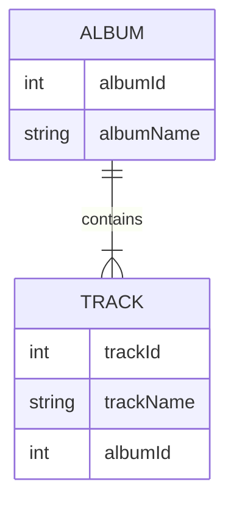

Der Datenreplikator kann Ihre Daten in NDJSON-Dateien (Datenarchive) mit einer echten Datenbank synchronisieren. Dabei bleiben Beziehungen erhalten. Die Synchronisierung erfolgt in eine Richtung, von den Daten des Datenarchivs in die Datenbank.

Der Datenreplikator wird über den [Data deployer](data-deployer) ausgeführt

### Was bedeutet es, Beziehungen zu erhalten?

Referenzen werden durch Fremd- und Primärschlüssel definiert. Diese Werte können sich in der Datenbank und im Archiv unterscheiden, aber der Replikator kann die Beziehungen zwischen Entitäten erhalten.

Wir zeigen dies anhand zweier verwandter Tabellen - Album und Track.

Die Tabelle Album sieht folgendermaßen aus. Beim Einfügen in die Datenbank ist albumId=1 bereits belegt, daher wählt der Replikator die erste freie ID, in diesem Beispiel 11:
| albumId - Archiv    | albumId - Datenbank | albumName |
| ----------- | ----------- | ----------- |
| 1      | 11 | A Hard Day's Night       |
| 2   | 12| Yellow Submarine        |

Die Tabelle Track hat eine Referenz auf das Album, daher muss sie die echten IDs (11, 12) verwenden, die in der Datenbank genutzt werden, anstelle der in der NDJSON-Datei gespeicherten IDs (1,2). Der Einfachheit halber nehmen wir an, dass die trackId in Datenbank und Archiv gleich ist.

| trackId | albumId - Archiv    | albumId - Datenbank | albumName |
| ----------- | ----------- | ----------- | ----------- |
| 21 | 1      | 11 | A Hard Day's Night       |
| 22 | 2   | 12| If I fell        |

Einstellungen pro Tabelle
- Key (match columns) - diese Einstellung wird gemeinsam mit dem Vergleich des Data deployers genutzt, sie definiert die eindeutige Spaltenkombination, die zum Zuordnen einer Entität verwendet wird
- Find existing row - aktivieren Sie dies, wenn Sie eine vorhandene Zeile in der Datenbank finden möchten. Wenn nicht aktiviert, ist die einzig mögliche Operation, jedes Mal eine neue Zeile anzulegen
  - Find condition - definieren Sie eine Bedingung, es werden nur Zeilen, die dieser Bedingung entsprechen, in der Datenbank gesucht
- Update existing row - nur verfügbar, wenn "Find existing row" aktiviert ist. Aktivieren Sie dies, wenn Sie die gefundene Zeile mit Werten aus dem Archiv aktualisieren möchten
  - Update condition - definieren Sie eine Bedingung, es werden nur Zeilen aktualisiert, die dieser Bedingung entsprechen
- Delete missing row - nur verfügbar, wenn "Find existing row" aktiviert ist. Aktivieren Sie dies, wenn Sie Zeilen löschen möchten, die nicht im Archiv enthalten sind
  - Restriction columns - es werden nur Zeilen mit Spaltenwerten aus dem Archiv gelöscht
- Create new row - legt eine neue Zeile an, wenn keine vorhandene Zeile gefunden wurde
  - Create condition - definieren Sie eine Bedingung, es werden nur Zeilen, die dieser Bedingung entsprechen, in der Datenbank angelegt

