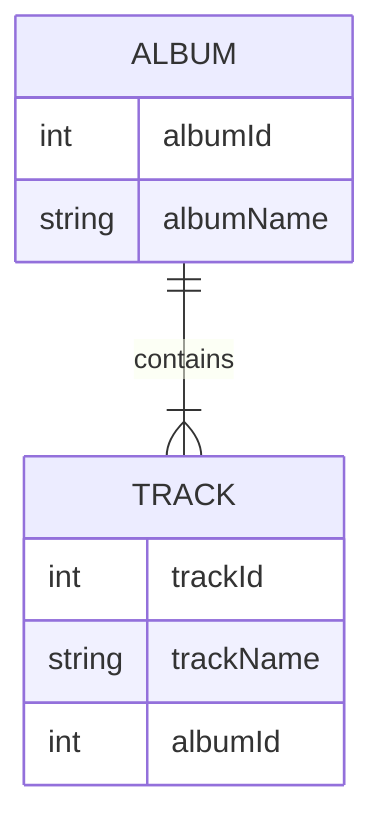

El replicador de datos puede sincronizar tus datos en archivos NDJSON (archivos de datos) con una base de datos real. Preserva las relaciones. La sincronización es unidireccional, desde los datos del archivo de datos hacia la base de datos.

El replicador de datos se ejecuta desde el [Desplegador de datos](data-deployer)

### ¿Qué significa preservar las relaciones?

Las referencias se definen mediante claves foráneas y primarias. Estos valores pueden ser diferentes en la base de datos y en el archivo, pero el replicador puede preservar las relaciones entre entidades.

Lo mostraremos en dos tablas relacionadas: Album y Track.

La tabla Album tiene el siguiente aspecto. Al insertar en la base de datos, albumId=1 ya está ocupado, por lo que el replicador elige el primer ID libre, que es 11 en este ejemplo:
| albumId - archivo    | albumId - base de datos | albumName |
| ----------- | ----------- | ----------- |
| 1      | 11 | A Hard Day's Night       |
| 2   | 12| Yellow Submarine        |

La tabla Track tiene una referencia al álbum, por lo que debe usar los IDs reales (11, 12) utilizados en la base de datos en lugar de los IDs guardados en el archivo NDJSON (1,2). Por simplicidad, asumimos que trackId es el mismo tanto en la base de datos como en el archivo.

| trackId | albumId - archivo    | albumId - base de datos | albumName |
| ----------- | ----------- | ----------- | ----------- |
| 21 | 1      | 11 | A Hard Day's Night       |
| 22 | 2   | 12| If I fell        |

Configuración por tabla
- Clave (columnas de coincidencia) - esta configuración se comparte con la comparación del desplegador de datos, define la combinación única de columnas utilizada para hacer coincidir la entidad
- Buscar fila existente - marca esta opción si quieres buscar una fila existente en la base de datos. Si no está marcada, la única operación posible será crear una fila nueva cada vez
  - Condición de búsqueda - define una condición, solo se buscarán en la base de datos las filas que cumplan esta condición
- Actualizar fila existente - disponible solo si "Buscar fila existente" está marcado. Marca esta opción si quieres actualizar la fila encontrada con los valores del archivo
  - Condición de actualización - define una condición, solo se actualizarán las filas que cumplan esta condición
- Eliminar fila faltante - disponible solo si "Buscar fila existente" está marcado. Marca esta opción si quieres eliminar las filas que no están en el archivo
  - Columnas de restricción - solo se eliminarán las filas con valores de columna procedentes del archivo
- Crear fila nueva - crea una fila nueva si no se encontró ninguna fila existente
  - Condición de creación - define una condición, solo se crearán en la base de datos las filas que cumplan esta condición

