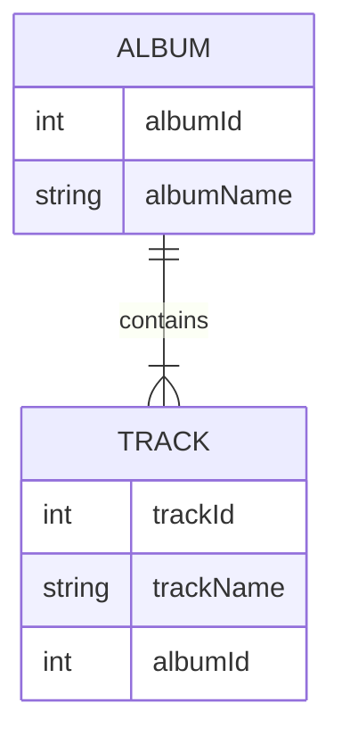

Le réplicateur de données peut synchroniser vos données contenues dans des fichiers NDJSON (archives de données) avec une base de données réelle. Il préserve les relations. La synchronisation est unidirectionnelle, depuis les données de l'archive vers la base de données.

Le réplicateur de données est exécuté depuis le [Déployeur de données](data-deployer)

### Que signifie préserver une relation ?

Les références sont définies par des clés étrangères et primaires. Ces valeurs peuvent être différentes dans la base de données et dans l'archive, mais le réplicateur peut préserver les relations entre les entités.

Nous allons illustrer cela sur deux tables liées - Album et Track.

La table Album ressemble à ce qui suit. Lors de l'insertion dans la base de données, albumId=1 est déjà occupé, le réplicateur choisit donc le premier ID libre, qui est 11 dans cet exemple :
| albumId - archive    | albumId - base de données | albumName |
| ----------- | ----------- | ----------- |
| 1      | 11 | A Hard Day's Night       |
| 2   | 12| Yellow Submarine        |

La table Track a une référence vers l'album, elle doit donc utiliser les vrais ID (11, 12) utilisés dans la base de données au lieu des ID enregistrés dans le fichier NDJSON (1, 2). Par souci de simplicité, nous supposons que trackId est le même dans la base de données et dans l'archive.

| trackId | albumId - archive    | albumId - base de données | albumName |
| ----------- | ----------- | ----------- | ----------- |
| 21 | 1      | 11 | A Hard Day's Night       |
| 22 | 2   | 12| If I fell        |

Paramètres par table
- Clé (colonnes de correspondance) - ce paramètre est partagé avec la comparaison du déployeur de données, il définit la combinaison unique de colonnes utilisée pour faire correspondre l'entité
- Rechercher une ligne existante - cochez si vous souhaitez rechercher une ligne existante dans la base de données. Si cette option n'est pas cochée, la seule opération possible sera de créer une nouvelle ligne à chaque fois
  - Condition de recherche - définissez une condition, seules les lignes correspondant à cette condition seront recherchées dans la base de données
- Mettre à jour la ligne existante - disponible uniquement si « Rechercher une ligne existante » est coché. Cochez si vous souhaitez mettre à jour la ligne trouvée avec les valeurs de l'archive
  - Condition de mise à jour - définissez une condition, seules les lignes correspondant à cette condition seront mises à jour
- Supprimer la ligne manquante - disponible uniquement si « Rechercher une ligne existante » est coché. Cochez si vous souhaitez supprimer les lignes qui ne sont pas dans l'archive
  - Colonnes de restriction - seules les lignes dont les valeurs de colonnes proviennent de l'archive seront supprimées
- Créer une nouvelle ligne - crée une nouvelle ligne si aucune ligne existante n'a été trouvée
  - Condition de création - définissez une condition, seules les lignes correspondant à cette condition seront créées dans la base de données

