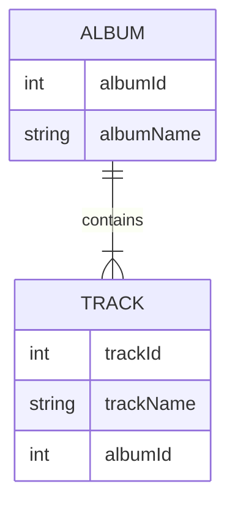

Il replicatore di dati può sincronizzare i tuoi dati contenuti in file NDJSON (archivi di dati) con un database reale. Preserva le relazioni. La sincronizzazione è unidirezionale, dai dati dell'archivio verso il database.

Il replicatore di dati viene eseguito da [Data deployer](data-deployer)

### Cosa significa preservare le relazioni?

I riferimenti sono definiti da chiavi esterne e chiavi primarie. Questi valori possono essere diversi nel database e nell'archivio, ma il replicatore può preservare le relazioni tra le entità.

Lo mostreremo su due tabelle correlate: Album e Track.

La tabella Album si presenta come segue. Durante l'inserimento nel database, albumId=1 è già occupato, quindi il replicatore sceglie il primo ID libero, che in questo esempio è 11:
| albumId - archivio    | albumId - database | albumName |
| ----------- | ----------- | ----------- |
| 1      | 11 | A Hard Day's Night       |
| 2   | 12| Yellow Submarine        |

La tabella Track ha un riferimento all'album, quindi deve usare gli ID reali (11, 12) utilizzati nel database invece degli ID salvati nel file NDJSON (1, 2). Per semplicità, assumiamo che trackId sia lo stesso sia nel database che nell'archivio.

| trackId | albumId - archivio    | albumId - database | albumName |
| ----------- | ----------- | ----------- | ----------- |
| 21 | 1      | 11 | A Hard Day's Night       |
| 22 | 2   | 12| If I fell        |

Impostazioni per tabella
- Key (match columns) - questa impostazione è condivisa con il confronto del data deployer, definisce la combinazione univoca di colonne usata per l'abbinamento delle entità
- Find existing row - seleziona questa opzione se vuoi cercare una riga esistente nel database. Se non è selezionata, l'unica operazione possibile sarà creare ogni volta una nuova riga
  - Find condition - definisci una condizione, solo le righe che soddisfano questa condizione verranno cercate nel database
- Update existing row - disponibile solo se "Find existing row" è selezionato. Seleziona questa opzione se vuoi aggiornare la riga trovata con i valori dell'archivio
  - Update condition - definisci una condizione, solo le righe che soddisfano questa condizione verranno aggiornate
- Delete missing row - disponibile solo se "Find existing row" è selezionato. Seleziona questa opzione se vuoi eliminare le righe che non sono presenti nell'archivio
  - Restriction columns - verranno eliminate solo le righe con valori di colonna provenienti dall'archivio
- Create new row - crea una nuova riga, se non è stata trovata alcuna riga esistente
  - Create condition - definisci una condizione, solo le righe che soddisfano questa condizione verranno create nel database

