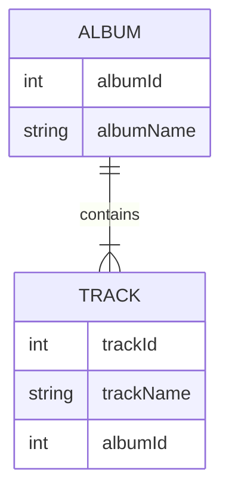

データレプリケーターは、NDJSON ファイル（データアーカイブ）内のデータを実際のデータベースと同期できます。リレーションシップは保持されます。同期は一方向で、データアーカイブのデータからデータベースへ向かって行われます。

データレプリケーターは [データデプロイヤー](data-deployer) から実行します。

### リレーションシップを保持するとはどういう意味か？

参照は外部キーと主キーによって定義されます。これらの値はデータベースとアーカイブとで異なる場合がありますが、レプリケーターはエンティティ間のリレーションシップを保持できます。

これを、関連する 2 つのテーブル（Album と Track）を使って説明します。

Album テーブルは以下のようになっています。データベースへ挿入する際、albumId=1 はすでに使用されているため、レプリケーターは最初の空き ID を選択します。この例では 11 になります。
| albumId - アーカイブ    | albumId - データベース | albumName |
| ----------- | ----------- | ----------- |
| 1      | 11 | A Hard Day's Night       |
| 2   | 12| Yellow Submarine        |

Track テーブルは album への参照を持つため、NDJSON ファイルに保存された ID（1、2）ではなく、データベースで使用されている実際の ID（11、12）を使用する必要があります。簡単のため、trackId はデータベースとアーカイブで同じであると仮定します。

| trackId | albumId - アーカイブ    | albumId - データベース | albumName |
| ----------- | ----------- | ----------- | ----------- |
| 21 | 1      | 11 | A Hard Day's Night       |
| 22 | 2   | 12| If I fell        |

テーブルごとの設定
- Key（一致列） - この設定はデータデプロイヤーの比較と共有され、エンティティの照合に使用される列の一意な組み合わせを定義します
- Find existing row - データベース内の既存行を検索したい場合にチェックします。チェックしない場合、可能な操作は毎回新しい行を作成することだけになります
  - Find condition - 条件を定義します。この条件に一致する行のみがデータベース内で検索されます
- Update existing row - 「Find existing row」がチェックされている場合のみ利用可能です。見つかった行をアーカイブの値で更新したい場合にチェックします
  - Update condition - 条件を定義します。この条件に一致する行のみが更新されます
- Delete missing row - 「Find existing row」がチェックされている場合のみ利用可能です。アーカイブに存在しない行を削除したい場合にチェックします
  - Restriction columns - アーカイブの列値を持つ行のみが削除されます
- Create new row - 既存の行が見つからなかった場合に新しい行を作成します
  - Create condition - 条件を定義します。この条件に一致する行のみがデータベース内に作成されます

