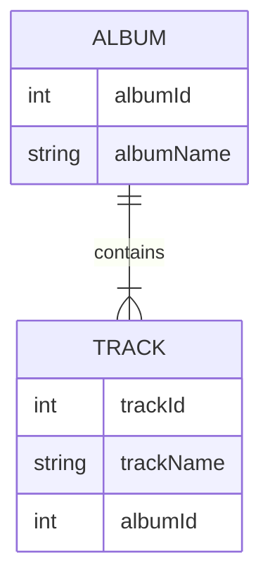

데이터 복제기는 NDJSON 파일(데이터 아카이브)의 데이터를 실제 데이터베이스와 동기화할 수 있습니다. 이때 관계가 그대로 유지됩니다. 동기화는 단방향으로, 데이터 아카이브의 데이터에서 데이터베이스 방향으로 진행됩니다.

데이터 복제기는 [데이터 배포기](data-deployer)에서 실행됩니다.

### 관계를 유지한다는 것은 무슨 의미인가요?

참조는 외래 키와 기본 키로 정의됩니다. 이 값들은 데이터베이스와 아카이브에서 서로 다를 수 있지만, 복제기는 엔터티 간의 관계를 유지할 수 있습니다.

관련된 두 개의 테이블인 Album과 Track을 예로 들어 설명하겠습니다.

Album 테이블은 다음과 같습니다. 데이터베이스에 삽입할 때 albumId=1은 이미 사용 중이므로, 복제기는 첫 번째로 비어 있는 ID를 선택하며, 이 예제에서는 11입니다:
| albumId - 아카이브    | albumId - 데이터베이스 | albumName |
| ----------- | ----------- | ----------- |
| 1      | 11 | A Hard Day's Night       |
| 2   | 12| Yellow Submarine        |

Track 테이블은 album에 대한 참조를 가지고 있으므로, NDJSON 파일에 저장된 ID(1, 2) 대신 데이터베이스에서 사용되는 실제 ID(11, 12)를 사용해야 합니다. 단순화를 위해 trackId는 데이터베이스와 아카이브에서 동일하다고 가정합니다.

| trackId | albumId - 아카이브    | albumId - 데이터베이스 | albumName |
| ----------- | ----------- | ----------- | ----------- |
| 21 | 1      | 11 | A Hard Day's Night       |
| 22 | 2   | 12| If I fell        |

테이블별 설정
- 키(일치 열) - 이 설정은 데이터 배포기 비교와 공유되며, 엔터티 매칭에 사용되는 고유한 열 조합을 정의합니다
- 기존 행 찾기 - 데이터베이스에서 기존 행을 찾으려면 선택하세요. 선택하지 않으면 매번 새 행을 생성하는 작업만 가능합니다
  - 찾기 조건 - 조건을 정의합니다. 이 조건과 일치하는 행만 데이터베이스에서 검색됩니다
- 기존 행 업데이트 - "기존 행 찾기"가 선택된 경우에만 사용할 수 있습니다. 찾은 행을 아카이브의 값으로 업데이트하려면 선택하세요
  - 업데이트 조건 - 조건을 정의합니다. 이 조건과 일치하는 행만 업데이트됩니다
- 누락된 행 삭제 - "기존 행 찾기"가 선택된 경우에만 사용할 수 있습니다. 아카이브에 없는 행을 삭제하려면 선택하세요
  - 제한 열 - 아카이브의 열 값을 가진 행만 삭제됩니다
- 새 행 생성 - 기존 행을 찾지 못한 경우 새 행을 생성합니다
  - 생성 조건 - 조건을 정의합니다. 이 조건과 일치하는 행만 데이터베이스에 생성됩니다

