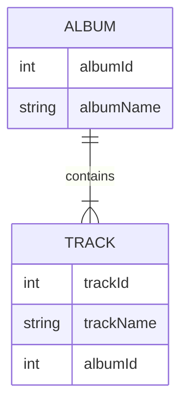

O replicador de dados pode sincronizar seus dados em arquivos NDJSON (arquivos de dados) com um banco de dados real. Ele preserva os relacionamentos. A sincronização é unidirecional, dos dados do arquivo de dados para o banco de dados.

O replicador de dados é executado a partir do [Data deployer](data-deployer)

### O que significa preservar o relacionamento?

As referências são definidas por chaves estrangeiras e primárias. Esses valores podem ser diferentes no banco de dados e no arquivo de dados, mas o replicador consegue preservar os relacionamentos entre as entidades.

Vamos demonstrar isso em duas tabelas relacionadas - Album e Track.

A tabela Album é como a seguir. Ao inserir no banco de dados, albumId=1 já está ocupado, então o replicador escolhe o primeiro ID livre, que é 11 neste exemplo:
| albumId - arquivo    | albumId - banco de dados | albumName |
| ----------- | ----------- | ----------- |
| 1      | 11 | A Hard Day's Night       |
| 2   | 12| Yellow Submarine        |

A tabela Track tem uma referência ao álbum, portanto deve usar os IDs reais (11, 12) usados no banco de dados em vez dos IDs salvos no arquivo NDJSON (1,2). Para simplificar, assumimos que trackId é o mesmo tanto no banco de dados quanto no arquivo de dados.

| trackId | albumId - arquivo    | albumId - banco de dados | albumName |
| ----------- | ----------- | ----------- | ----------- |
| 21 | 1      | 11 | A Hard Day's Night       |
| 22 | 2   | 12| If I fell        |

Configurações por tabela
- Key (match columns) - esta configuração é compartilhada com a comparação do data deployer, ela define a combinação única de colunas usada para corresponder à entidade
- Find existing row - marque se você quiser encontrar uma linha existente no banco de dados. Se não estiver marcado, a única operação possível será criar uma nova linha sempre
  - Find condition - defina a condição, apenas as linhas que correspondem a esta condição serão procuradas no banco de dados
- Update existing row - disponível apenas se "Find existing row" estiver marcado. Marque se você quiser atualizar a linha encontrada com os valores do arquivo de dados
  - Update condition - defina a condição, apenas as linhas que correspondem a esta condição serão atualizadas
- Delete missing row - disponível apenas se "Find existing row" estiver marcado. Marque se você quiser excluir as linhas que não estão no arquivo de dados
  - Restriction columns - apenas as linhas com valores de coluna do arquivo de dados serão excluídas
- Create new row - cria uma nova linha, se nenhuma linha existente for encontrada
  - Create condition - defina a condição, apenas as linhas que correspondem a esta condição serão criadas no banco de dados

