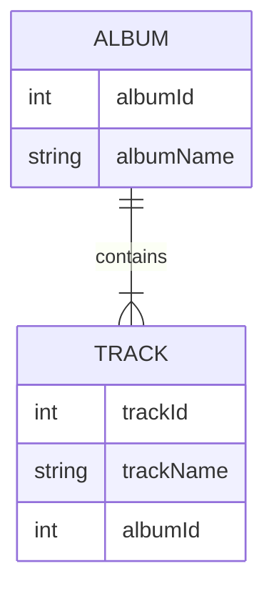

Replikátor dát dokáže synchronizovať vaše dáta v súboroch NDJSON (dátové archívy) so skutočnou databázou. Zachováva pritom vzťahy. Synchronizácia je jednosmerná, z dát dátového archívu do databázy.

Replikátor dát sa spúšťa z [Nasadzovača dát](data-deployer)

### Čo znamená zachovanie vzťahov?

Referencie sú definované cudzími a primárnymi kľúčmi. Tieto hodnoty môžu byť v databáze a v archíve rozdielne, ale replikátor dokáže zachovať vzťahy medzi entitami.

Ukážeme si to na dvoch súvisiacich tabuľkách – Album a Track.

Tabuľka Album vyzerá nasledovne. Pri vkladaní do databázy je albumId=1 už obsadené, takže replikátor zvolí prvé voľné ID, ktorým je v tejto ukážke 11:
| albumId - archív    | albumId - databáza | albumName |
| ----------- | ----------- | ----------- |
| 1      | 11 | A Hard Day's Night       |
| 2   | 12| Yellow Submarine        |

Tabuľka Track má referenciu na album, takže musí použiť skutočné ID (11, 12) použité v databáze namiesto ID uložených v súbore NDJSON (1,2). Pre jednoduchosť predpokladáme, že trackId je rovnaké v databáze aj v archíve.

| trackId | albumId - archív    | albumId - databáza | albumName |
| ----------- | ----------- | ----------- | ----------- |
| 21 | 1      | 11 | A Hard Day's Night       |
| 22 | 2   | 12| If I fell        |

Nastavenia pre jednotlivé tabuľky
- Key (match columns) – toto nastavenie je zdieľané s porovnaním v nasadzovači dát, definuje jedinečnú kombináciu stĺpcov použitú na priradenie entity
- Find existing row – zaškrtnite, ak chcete v databáze nájsť existujúci riadok. Ak nie je zaškrtnuté, jedinou možnou operáciou bude vždy vytvorenie nového riadka
  - Find condition – definujte podmienku, v databáze sa budú vyhľadávať len riadky zodpovedajúce tejto podmienke
- Update existing row – dostupné len vtedy, ak je zaškrtnuté „Find existing row“. Zaškrtnite, ak chcete nájdený riadok aktualizovať hodnotami z archívu
  - Update condition – definujte podmienku, aktualizované budú len riadky zodpovedajúce tejto podmienke
- Delete missing row – dostupné len vtedy, ak je zaškrtnuté „Find existing row“. Zaškrtnite, ak chcete odstrániť riadky, ktoré nie sú v archíve
  - Restriction columns – odstránené budú len riadky s hodnotami stĺpcov z archívu
- Create new row – vytvorí nový riadok, ak sa nenašiel žiadny existujúci riadok
  - Create condition – definujte podmienku, v databáze sa vytvoria len riadky zodpovedajúce tejto podmienke

