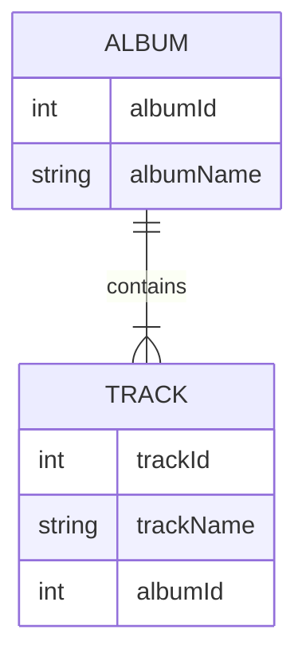

数据复制器可以将 NDJSON 文件（数据归档）中的数据与真实数据库同步。它会保留关系。同步是单向的，从数据归档中的数据同步到数据库。

数据复制器从 [数据部署器](data-deployer) 中执行

### 保留关系是什么意思？

引用由外键和主键定义。这些值在数据库和归档中可能不同，但复制器可以保留实体之间的关系。

我们将通过两个相关的表来说明这一点 - Album 和 Track。

Album 表如下所示。插入数据库时，albumId=1 已被占用，因此复制器会选择第一个空闲的 ID，在此示例中为 11：
| albumId - 归档    | albumId - 数据库 | albumName |
| ----------- | ----------- | ----------- |
| 1      | 11 | A Hard Day's Night       |
| 2   | 12| Yellow Submarine        |

Track 表引用了 album，因此它必须使用数据库中实际使用的 ID（11、12），而不是保存在 NDJSON 文件中的 ID（1、2）。为简单起见，我们假设 trackId 在数据库和归档中是相同的。

| trackId | albumId - 归档    | albumId - 数据库 | albumName |
| ----------- | ----------- | ----------- | ----------- |
| 21 | 1      | 11 | A Hard Day's Night       |
| 22 | 2   | 12| If I fell        |

每个表的设置
- Key（匹配列）- 此设置与数据部署器的比较功能共享，它定义用于匹配实体的唯一列组合
- 查找现有行 - 如果你想在数据库中查找现有行，请勾选此项。如果不勾选，唯一可能的操作是每次都创建新行
  - 查找条件 - 定义条件，只有匹配此条件的行才会在数据库中被查找
- 更新现有行 - 仅在勾选“查找现有行”时可用。如果你想用归档中的值更新找到的行，请勾选此项
  - 更新条件 - 定义条件，只有匹配此条件的行才会被更新
- 删除缺失行 - 仅在勾选“查找现有行”时可用。如果你想删除归档中不存在的行，请勾选此项
  - 限制列 - 只有列值来自归档的行才会被删除
- 创建新行 - 如果未找到现有行，则创建新行
  - 创建条件 - 定义条件，只有匹配此条件的行才会在数据库中被创建

